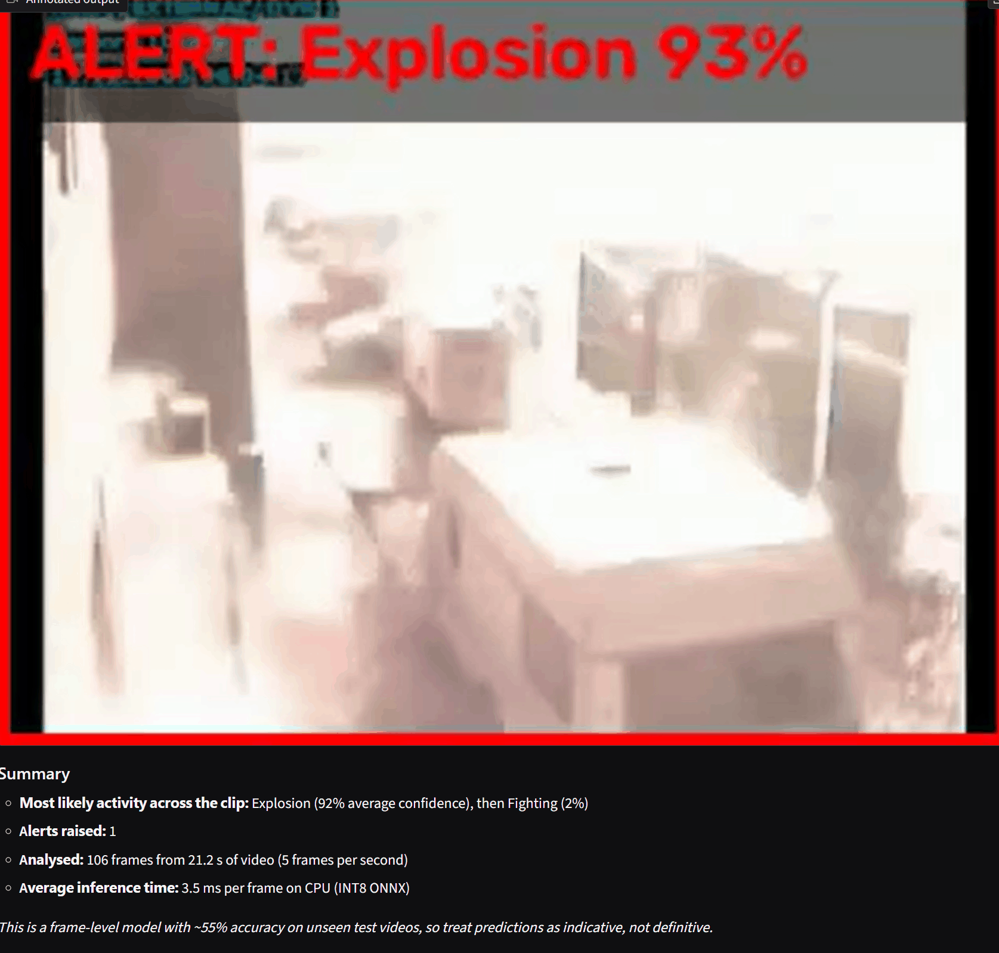
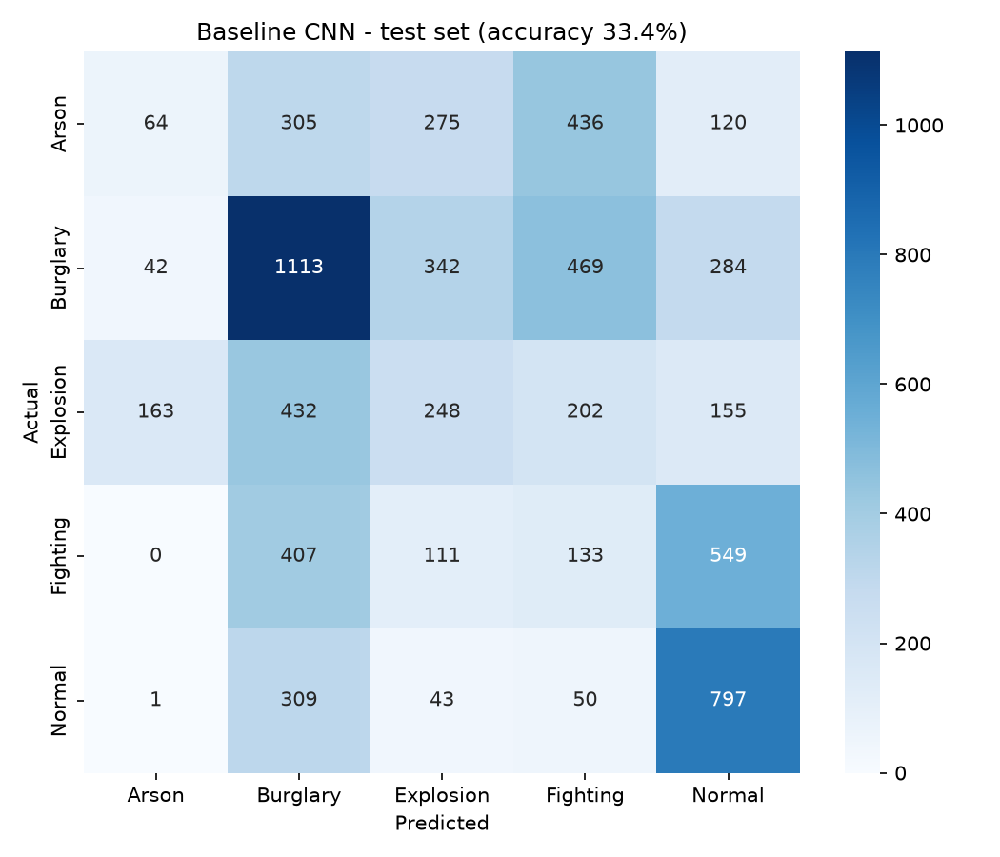
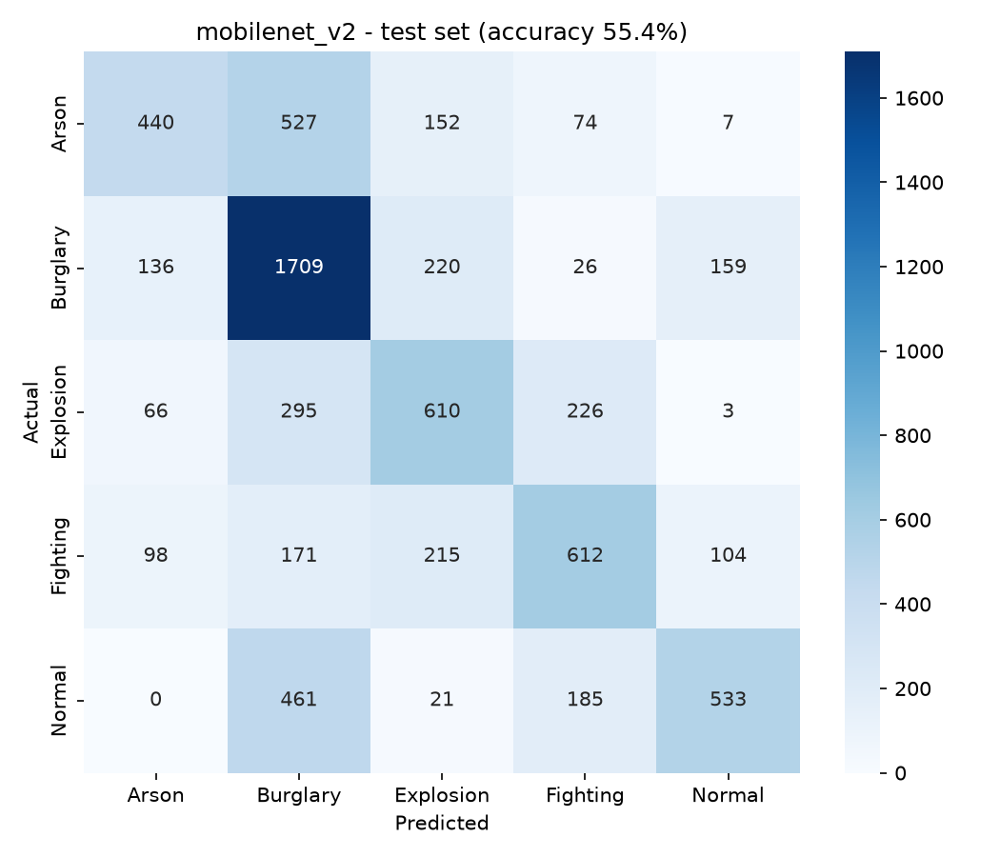

# Real-Time Anomaly Detection in Surveillance Video

A from-scratch reimplementation of my co-authored paper **"Anomaly Activity Detection on Real Time Surveillance Videos with Deep Learning"** (IJIRCCE, Vol. 12, Issue 5, May 2024, [DOI: 10.15680/IJIRCCE.2024.1205013](https://ijircce.com/admin/main/storage/app/pdf/LsdYlUu78r3f2JjfteavUUHZJ6b6Gbo2oo6F2l1F.pdf)), extended with **edge deployment**: ONNX export, INT8 quantisation and CPU benchmarking.

The original 2023 project code was lost, so I rebuilt the system from the paper, this time with a stricter evaluation method and a focus on running the model efficiently on low-power devices.

---

## What it does

Classifies frames from CCTV footage into five classes — **Arson, Burglary, Explosion, Fighting, Normal** — using the [UCF-Crime](https://www.crcv.ucf.edu/projects/real-world/) dataset of real-world surveillance videos.

```
videos ──► extract_frames.py ──► train.py ──► export_onnx.py
           (video-level split)   (CNN /        (ONNX FP32 → INT8,
                                  MobileNetV2)   CPU benchmark)
```

## Demo

A browser app (`app.py`, built with Gradio) lets you upload a CCTV clip and watch the **INT8 model running on the CPU**: the video comes back with a live overlay and a red **ALERT** banner when abnormal activity persists, plus a confidence timeline and a timestamped alert log. Predictions are smoothed over several frames so a single odd frame doesn't trigger an alarm.



## Key results

All results are on **test videos the model never saw during training**.

### Model comparison

| Model | Test accuracy | Macro-F1 | Parameters | Training time (RTX 4070 Laptop) |
|---|---|---|---|---|
| Baseline CNN (paper-style, from scratch) | 33.4% | 0.279 | 0.42 M | 4.7 min |
| **MobileNetV2 (ImageNet-pretrained, fine-tuned)** | **55.4%** | **0.530** | 2.23 M | 3.5 min |

Random guessing across five classes would score 20%.

### Edge benchmark (MobileNetV2, ONNX Runtime, CPU, batch size 1)

| Model | Size (MB) | Latency, 1 thread (ms) | Latency, 32 threads (ms) | Test accuracy | Macro-F1 |
|---|---|---|---|---|---|
| FP32 | 8.89 | 2.90 | 2.45 | 55.4% | 0.529 |
| **INT8** | **2.61** | **2.57** | 5.11 | 54.4% | 0.522 |

**INT8 is 3.4× smaller with less than 1 point of accuracy loss.** PyTorch and ONNX outputs match to within 1.4 × 10⁻⁶.

| Baseline CNN | MobileNetV2 |
|---|---|
|  |  |

## What I learned

**1. Splitting by video, not by frame, changes everything.**
Frames from the same video are nearly identical. If they land in both the training and test sets, a model can "recognise the video" rather than the activity. Here, every video belongs to exactly one of train (70%), validation (15%) or test (15%), assigned by `extract_frames.py` with a fixed random seed so the split is reproducible. The baseline CNN reached **99.6% training accuracy but only 33.4% on unseen videos** — the kind of gap a frame-level split would hide. The original paper reported 95% accuracy without describing its split; this rebuild deliberately uses the stricter method.

**2. Transfer learning matters on small datasets.**
With only ~250 training videos, a pretrained MobileNetV2 improved accuracy by 22 points and every class's F1 score, while training in less time.

**3. Quantisation isn't automatically faster — it depends on the hardware.**
INT8 cut the model size by 3.4× but was only 1.1× faster on one thread, and *slower* with 32 threads, on my x86 laptop CPU. The model is small, modern x86 CPUs are very fast at FP32, and quantise/dequantise steps plus thread coordination add overhead for a single small frame. CPUs with dedicated INT8 dot-product instructions (common on recent Arm cores) are where INT8 typically pays off — testing that is on the roadmap.

## Limitations

- **Noisy labels:** every frame of an anomaly video gets the video's label, but much of a burglary video is an empty room. This caps frame-level accuracy.
- **Overfitting:** both models reach ~99% training accuracy; more data, stronger augmentation or temporal models would help.
- **Single frames only:** the model sees one frame at a time and has no sense of motion.

## Roadmap

- [ ] C++ inference program using ONNX Runtime
- [x] Browser demo on uploaded video with prediction smoothing and alert logging (`app.py`)
- [ ] Live webcam / RTSP camera stream input
- [ ] Video-level evaluation (aggregating frame predictions per video)
- [ ] Benchmark FP32 vs INT8 on an Arm device (Raspberry Pi)
- [ ] Temporal models (e.g. frame features + LSTM) to use motion information

## How to run

Tested on Ubuntu 24.04 (WSL2), Python 3.12, NVIDIA RTX 4070 Laptop GPU.

```bash
python3 -m venv .venv && source .venv/bin/activate
pip install -r requirements.txt

# 1. Put the UCF-Crime videos under data/raw/ (Arson, Burglary, Explosion,
#    Fighting folders and Normal_Videos_for_Event_Recognition)
python extract_frames.py --raw data/raw --out data/frames

# 2. Train and evaluate
python train.py --model baseline
python train.py --model mobilenet

# 3. Export to ONNX, quantise to INT8 and benchmark on CPU
python export_onnx.py --checkpoint models/mobilenet_v2.pt

# 4. Launch the browser demo, then open http://localhost:7860
python app.py
```

## Repository structure

```
extract_frames.py   frame extraction + video-level train/val/test split
train.py            baseline CNN and MobileNetV2 training and evaluation
export_onnx.py      ONNX export, INT8 static quantisation, CPU benchmark
app.py              Gradio browser demo: annotated video, timeline, alert log
models/             trained PyTorch checkpoints and ONNX models
results/            classification reports, confusion matrices, curves, benchmarks
```

## Credits

- Original paper: Sai Deshith, Yashwanth Putluru, Sai Deshik, Deekshith Koripalli — BMS Institute of Technology and Management, Bengaluru (IJIRCCE, 2024).
- Dataset: W. Sultani, C. Chen, M. Shah, *Real-world Anomaly Detection in Surveillance Videos*, CVPR 2018.
- This repository is my own reimplementation (2026).
